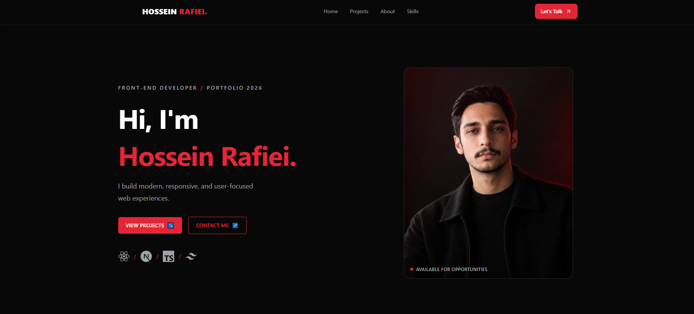
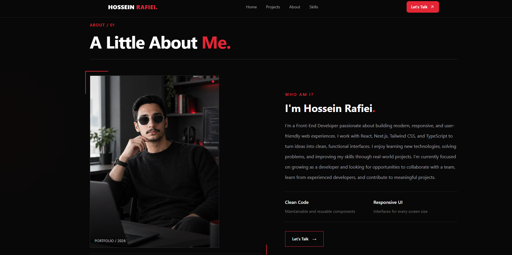
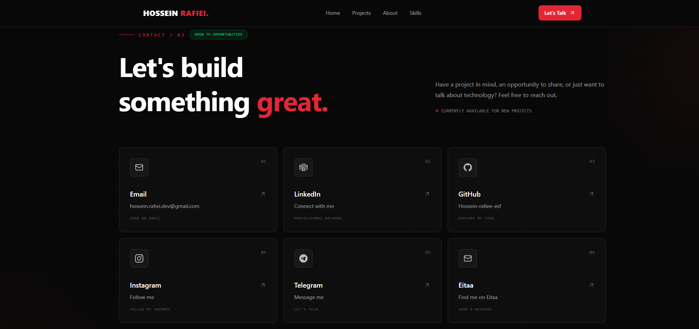
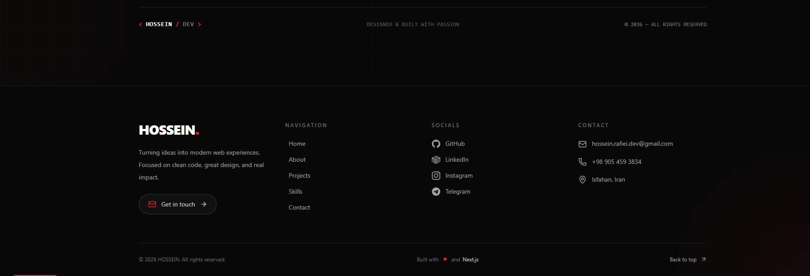

# HOSSEIN RAFIEI | Front-End Developer

A modern, responsive personal portfolio built with Next.js, TypeScript, and Tailwind CSS. Designed to showcase my skills, projects, and front-end development journey with a minimal dark UI and smooth animations.

## 🚀 Portfolio Preview

### Hero



### About Me


### Contact



### Footer



## ✨ Features

- Responsive design for desktop and mobile
- Minimal dark theme with red accents
- Hero, About, Skills, Projects, and Contact sections
- Smooth scroll-reveal animations
- Reusable React components
- Modern UI built with Tailwind CSS

## 🛠️ Tech Stack

- Next.js
- React
- TypeScript
- Tailwind CSS
- GSAP
- Lucide React
- Git & GitHub

## 💻 Run Locally

Clone the repository:

```bash
git clone https://github.com/Hossein-Rafiei-dev/my-portfolio.git
```

Navigate to the project directory:

```bash
cd my-portfolio
```

Install dependencies:

```bash
npm install
```

Start the development server:

```bash
npm run dev
```

Open [http://localhost:3000](http://localhost:3000) in your browser.

## 📂 Featured Project

### GAMERGEAR

A gaming accessories storefront built with Next.js and Tailwind CSS.

[View GAMERGEAR on GitHub](https://github.com/Hossein-rafiee-esf/GAMERGEAR)

## 📬 Contact

- **GitHub:** [Hossein-Rafiei-dev](https://github.com/Hossein-Rafiei-dev)
- **LinkedIn:** [Hossein Rafiei](https://www.linkedin.com/in/hossein-rafiei-53ab32419)
- **Email:** hossein.rafiei.dev@gmail.com

---

*Built with passion for front-end development.*
